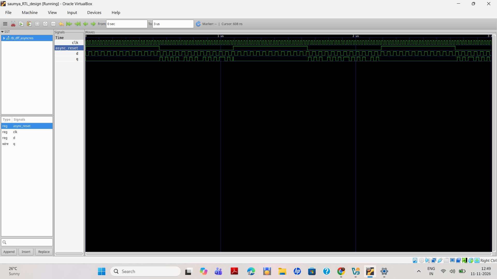
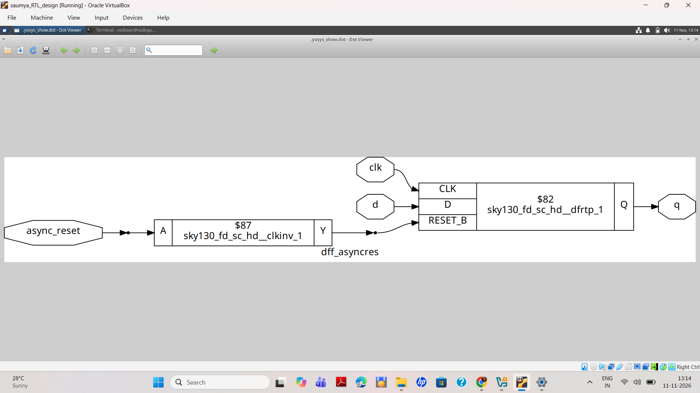
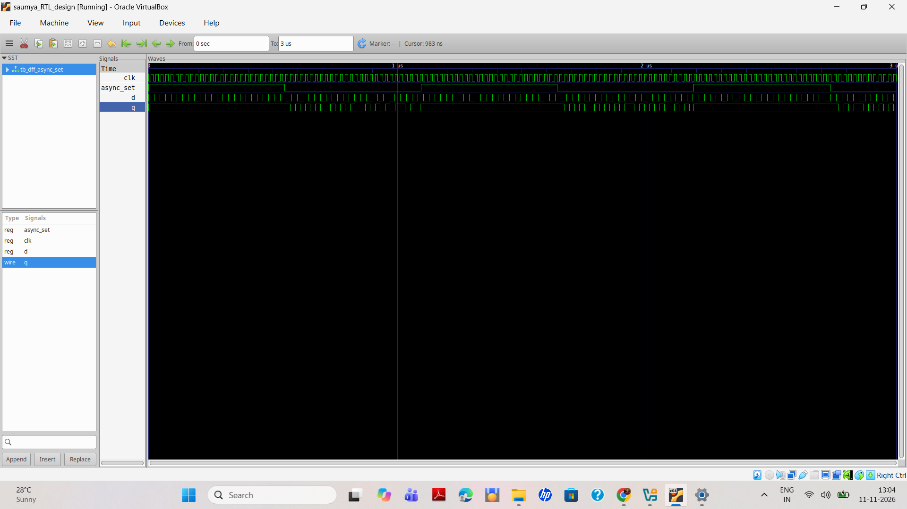
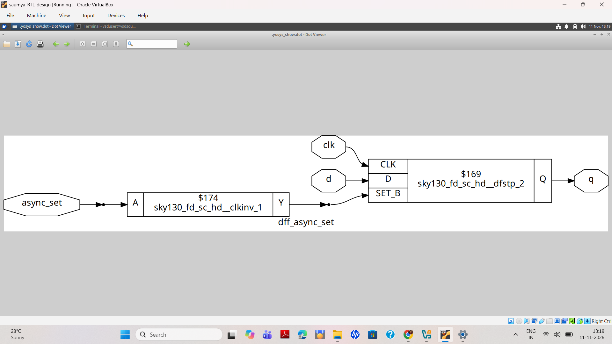
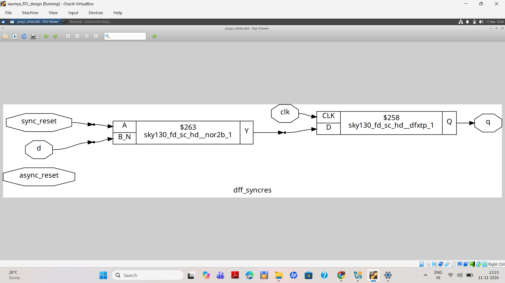
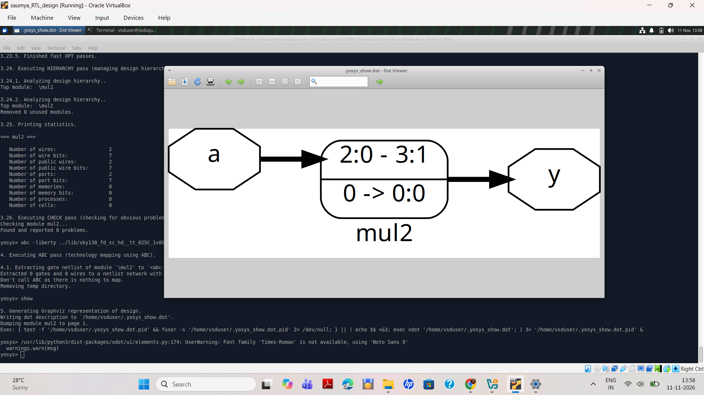
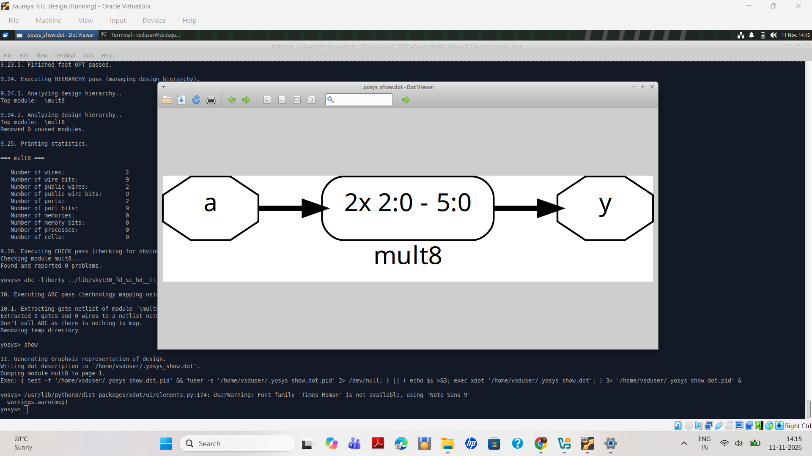

# Lab 2 — RTL Design, Simulation and Synthesis Using Sky130

## 1. Introduction

This lab focuses on Verilog RTL design, hierarchical design, sequential circuits, functional simulation, and technology mapping using the Sky130 High-Density (HD) standard-cell library.

The practical exercises covered in this lab are:

1. Hierarchical design using multiple Verilog modules.
2. Asynchronous reset D Flip-Flop simulation and synthesis.
3. Asynchronous set D Flip-Flop simulation and synthesis.
4. Synchronous reset D Flip-Flop synthesis.
5. Multiplication by 2 using Verilog RTL and Yosys synthesis.

The objective is to understand how RTL designs are simulated, analyzed, optimized, and mapped to standard cells.

---

## 2. Tools and Environment

| Parameter | Details |
|---|---|
| Operating System | Ubuntu 24.04 LTS |
| Virtualization | Oracle VirtualBox |
| RTL Language | Verilog HDL |
| Simulation Tool | Icarus Verilog |
| Waveform Viewer | GTKWave |
| Synthesis Tool | Yosys 0.47+121 |
| Schematic Viewer | Graphviz / xdot |
| Standard-Cell Library | Sky130 HD |
| Liberty File | `sky130_fd_sc_hd__tt_025C_1v80.lib` |

### Repository Working Directory

All practical commands were executed from the following directory:

```bash
cd ~/Desktop/sky130RTLDesignAndSynthesisWorkshop/verilog_files
```

The Sky130 Liberty file is located at:

```text
../lib/sky130_fd_sc_hd__tt_025C_1v80.lib
```

### Lab 2 Screenshot Directory

All screenshots related to this lab are maintained in the `lab_2` directory.

---

# Experiment 1 — Hierarchical Design Using Multiple Modules

## 3. Objective

To understand hierarchical RTL design and module instantiation by connecting multiple Verilog modules to form a top-level design.

## 3.1 RTL Design

The design consists of three modules:

- `sub_module1` — performs an AND operation.
- `sub_module2` — performs an OR operation.
- `multiple_modules` — top-level module connecting both submodules.

### RTL File: `multiple_modules.v`

```verilog
module sub_module2 (
    input a,
    input b,
    output y
);
    assign y = a | b;
endmodule

module sub_module1 (
    input a,
    input b,
    output y
);
    assign y = a & b;
endmodule

module multiple_modules (
    input a,
    input b,
    input c,
    output y
);

    wire net1;

    sub_module1 u1 (
        .a(a),
        .b(b),
        .y(net1)
    );

    sub_module2 u2 (
        .a(net1),
        .b(c),
        .y(y)
    );

endmodule
```

## 3.2 Functional Explanation

The first submodule performs an AND operation:

```verilog
assign y = a & b;
```

Its output is connected to the intermediate signal `net1`.

The second submodule performs an OR operation:

```verilog
assign y = a | b;
```

Therefore:

\[
net1 = a \land b
\]

\[
y = net1 \lor c
\]

The final Boolean expression is:

\[
\boxed{y = (a \land b) \lor c}
\]

## 3.3 Yosys Synthesis Commands

Start Yosys from the Bash terminal:

```bash
yosys
```

Execute the following commands at the `yosys>` prompt:

```tcl
read_verilog multiple_modules.v
hierarchy -top multiple_modules
synth -top multiple_modules
stat
show
```

## 3.4 Hierarchical Design Schematic

The schematic illustrates how the two submodules are connected through the intermediate signal `net1`.


**Observation:**

- Inputs `a` and `b` are connected to `sub_module1`.
- The output of `sub_module1` is connected through `net1`.
- `sub_module2` receives `net1` and input `c`.
- The final output is generated at `y`.

### Submodule 1


### Multiple Module Netlist


---

# Experiment 2 — Asynchronous Reset D Flip-Flop

## 4. Objective

To simulate and synthesize a D Flip-Flop with an asynchronous active-low reset.

## 4.1 RTL and Testbench Files

| File | Description |
|---|---|
| `dff_asyncres.v` | RTL description of the asynchronous reset DFF |
| `tb_dff_asyncres.v` | Testbench used for simulation |

## 4.2 Simulation Procedure

Compile the RTL design and testbench using Icarus Verilog:

```bash
iverilog dff_asyncres.v tb_dff_asyncres.v
```

Run the simulation:

```bash
./a.out
```

The testbench generates the following waveform file:

```text
tb_dff_asyncres.vcd
```

Open the waveform using GTKWave:

```bash
gtkwave tb_dff_asyncres.vcd
```

## 4.3 Asynchronous Reset — Simulation Waveform

**Design:** `dff_asyncres.v`  
**Testbench:** `tb_dff_asyncres.v`  
**Waveform file:** `tb_dff_asyncres.vcd`



### Signals Observed

| Signal | Description |
|---|---|
| `clk` | Clock input |
| `async_reset` | Asynchronous reset input |
| `d` | Data input |
| `q` | Registered output |

### Simulation Result

The simulation completed successfully.

```text
VCD info: dumpfile tb_dff_asyncres.vcd opened for output.
tb_dff_asyncres.v:24: $finish called at 3000000 (1ps)
```

**Observation:**

The asynchronous reset controls the output independently of the clock edge. When reset is asserted, the output is reset without waiting for the next active clock edge.

## 4.4 Synthesis and Technology Mapping

Start Yosys:

```bash
yosys
```

Execute the following commands at the `yosys>` prompt:

```tcl
read_liberty -lib ../lib/sky130_fd_sc_hd__tt_025C_1v80.lib
read_verilog dff_asyncres.v
hierarchy -top dff_asyncres
synth -top dff_asyncres
dfflibmap -liberty ../lib/sky130_fd_sc_hd__tt_025C_1v80.lib
abc -liberty ../lib/sky130_fd_sc_hd__tt_025C_1v80.lib
clean
stat
show
```

## 4.5 Asynchronous Reset — Mapped Schematic



### Mapped Cells Observed

- `sky130_fd_sc_hd__clkinv_1`
- `sky130_fd_sc_hd__dfrtp_1`

**Observation:**

The reset path includes an inverter connected to the active-low reset pin (`RESET_B`) of the mapped Sky130 D Flip-Flop.

The schematic shows the mapped sequential cell and its clock, data, reset, and output connections.

---

# Experiment 3 — Asynchronous Set D Flip-Flop

## 5. Objective

To simulate and synthesize a D Flip-Flop with an asynchronous set input.

## 5.1 RTL and Testbench Files

| File | Description |
|---|---|
| `dff_async_set.v` | RTL description of the asynchronous set DFF |
| `tb_dff_async_set.v` | Testbench used for simulation |

## 5.2 Simulation Procedure

Compile the RTL design and testbench:

```bash
iverilog dff_async_set.v tb_dff_async_set.v
```

Run the simulation:

```bash
./a.out
```

The generated waveform file is:

```text
tb_dff_async_set.vcd
```

Open the waveform:

```bash
gtkwave tb_dff_async_set.vcd
```

## 5.3 Asynchronous Set — Simulation Waveform

**Design:** `dff_async_set.v`  
**Testbench:** `tb_dff_async_set.v`  
**Waveform file:** `tb_dff_async_set.vcd`



### Signals Observed

| Signal | Description |
|---|---|
| `clk` | Clock input |
| `async_set` | Asynchronous set input |
| `d` | Data input |
| `q` | Registered output |

### Simulation Result

The simulation completed successfully.

```text
VCD info: dumpfile tb_dff_async_set.vcd opened for output.
tb_dff_async_set.v:25: $finish called at 3000000 (1ps)
```

**Observation:**

The asynchronous set input forces the output to the set state independently of the clock edge.

## 5.4 Synthesis and Technology Mapping

At the `yosys>` prompt:

```tcl
read_liberty -lib ../lib/sky130_fd_sc_hd__tt_025C_1v80.lib
read_verilog dff_async_set.v
hierarchy -top dff_async_set
synth -top dff_async_set
dfflibmap -liberty ../lib/sky130_fd_sc_hd__tt_025C_1v80.lib
abc -liberty ../lib/sky130_fd_sc_hd__tt_025C_1v80.lib
clean
stat
show
```

## 5.5 Asynchronous Set — Mapped Schematic



### Mapped Cells Observed

- `sky130_fd_sc_hd__clkinv_1`
- `sky130_fd_sc_hd__dfstp_2`

**Observation:**

The schematic shows an inverter in the asynchronous set path and a Sky130 D Flip-Flop with an active-low set pin (`SET_B`).

---

# Experiment 4 — Synchronous Reset D Flip-Flop

## 6. Objective

To understand the synthesis implementation of a D Flip-Flop with synchronous reset and examine the mapped logic.

## 6.1 Synchronous Reset Concept

Unlike an asynchronous reset, a synchronous reset affects the stored output only at the active clock edge.

The reset condition is evaluated as part of the clocked data path.

## 6.2 Yosys Synthesis Commands

Start Yosys and execute the following commands:

```tcl
read_liberty -lib ../lib/sky130_fd_sc_hd__tt_025C_1v80.lib
read_verilog dff_syncres.v
hierarchy -top dff_syncres
synth -top dff_syncres
dfflibmap -liberty ../lib/sky130_fd_sc_hd__tt_025C_1v80.lib
abc -liberty ../lib/sky130_fd_sc_hd__tt_025C_1v80.lib
clean
stat
show
```

## 6.3 Synchronous Reset — Mapped Schematic



### Mapped Cells Observed

- `sky130_fd_sc_hd__nor2b_1`
- `sky130_fd_sc_hd__dfrtp_1`

**Observation:**

The mapped schematic shows reset-related combinational logic connected to a Sky130 D Flip-Flop.

The reset behavior is synchronous in the RTL; the mapped logic implements that behavior through the data path.

---

# Experiment 5 — Multiplication by 2 Using Verilog

## 7. Objective

To implement multiplication by 2 in Verilog and examine the RTL optimization performed by Yosys.

## 7.1 RTL Files

The multiplication examples used in this exercise include:

- `mult_2.v`
- `mult_8.v`

Open both files side by side using GVim:

```bash
gvim mult_*.v -o
```

## 7.2 Verilog RTL — Multiplication by 2

**RTL file:** `mult_2.v`  
**Top module:** `mul2`

```verilog
module mul2 (
    input [2:0] a,
    output [3:0] y
);

    assign y = a * 2;

endmodule
```

The design accepts a 3-bit input and generates a 4-bit output.

## 7.3 Yosys Synthesis Commands

Start Yosys:

```bash
yosys
```

At the `yosys>` prompt:

```tcl
read_liberty -lib ../lib/sky130_fd_sc_hd__tt_025C_1v80.lib
read_verilog mult_2.v
hierarchy -top mul2
synth -top mul2
abc -liberty ../lib/sky130_fd_sc_hd__tt_025C_1v80.lib
show mul2
```

## 7.4 Multiplication by 2 — Generated Schematic


## 7.5 Multiplication by 2 — Additional Schematic Result



## 7.6 Additional Synthesis Result



## 7.7 Generated Verilog Netlist

The synthesized netlist was saved as:

`mul2_netlist.v`

```verilog
module mul2(a, y);

    input [2:0] a;
    wire [2:0] a;

    output [3:0] y;
    wire [3:0] y;

    assign y = { a, 1'h0 };

endmodule
```

## 7.8 Understanding the Optimization

The original RTL expression is:

\[
y = a \times 2
\]

Multiplication by 2 is equivalent to shifting the input left by one bit:

\[
y = a \ll 1
\]

Yosys optimizes the multiplication into a bit connection:

```verilog
assign y = { a, 1'h0 };
```

The output mapping is:

| Output Bit | Source |
|---|---|
| `y[3]` | `a[2]` |
| `y[2]` | `a[1]` |
| `y[1]` | `a[0]` |
| `y[0]` | `1'b0` |

### Example

For the input:

```text
a = 3'b101
```

The output is:

```text
y = 4'b1010
```

**Observation:**

The generated netlist contains only bit connections and a constant zero. No standard-cell logic gates are required for this optimized operation.

---

# 8. Comparison of Reset Types

| Feature | Asynchronous Reset | Asynchronous Set | Synchronous Reset |
|---|---|---|---|
| Function | Reset output | Set output | Reset output |
| Clock dependency | Independent of clock | Independent of clock | Depends on active clock edge |
| Effect | Clears stored output | Sets stored output | Clears stored output at clock edge |
| Evidence in this lab | Simulation and schematic | Simulation and schematic | Mapped schematic |

---

# 9. Important Commands Reference

## 9.1 Simulation — Bash Terminal

### Asynchronous Reset

```bash
iverilog dff_asyncres.v tb_dff_asyncres.v
./a.out
gtkwave tb_dff_asyncres.vcd
```

### Asynchronous Set

```bash
iverilog dff_async_set.v tb_dff_async_set.v
./a.out
gtkwave tb_dff_async_set.vcd
```

## 9.2 Synthesis — Yosys

General synthesis flow for the sequential designs:

```tcl
read_liberty -lib ../lib/sky130_fd_sc_hd__tt_025C_1v80.lib
read_verilog <design_file.v>
hierarchy -top <top_module>
synth -top <top_module>
dfflibmap -liberty ../lib/sky130_fd_sc_hd__tt_025C_1v80.lib
abc -liberty ../lib/sky130_fd_sc_hd__tt_025C_1v80.lib
clean
stat
show
```

---

# 10. Conclusion

This lab provided practical experience in Verilog RTL design, simulation, hierarchical module instantiation, and synthesis using the Sky130 HD standard-cell library.

The major learning outcomes were:

1. Understanding hierarchical design and connections between Verilog modules.
2. Simulating asynchronous reset and asynchronous set D Flip-Flops.
3. Inspecting simulation waveforms using GTKWave.
4. Understanding the differences between synchronous and asynchronous reset behavior.
5. Mapping sequential RTL designs to Sky130 standard cells using Yosys.
6. Understanding how synthesis optimizes multiplication by 2 into simple bit connections.

The experiments demonstrated the RTL-to-synthesis workflow using Icarus Verilog, GTKWave, Yosys, and the Sky130 standard-cell library.
