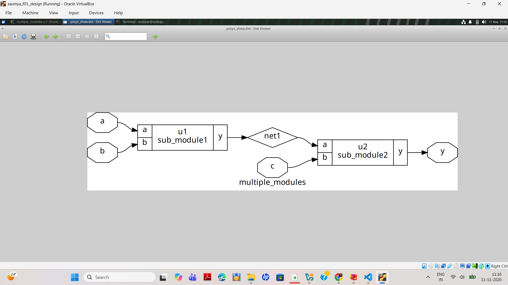
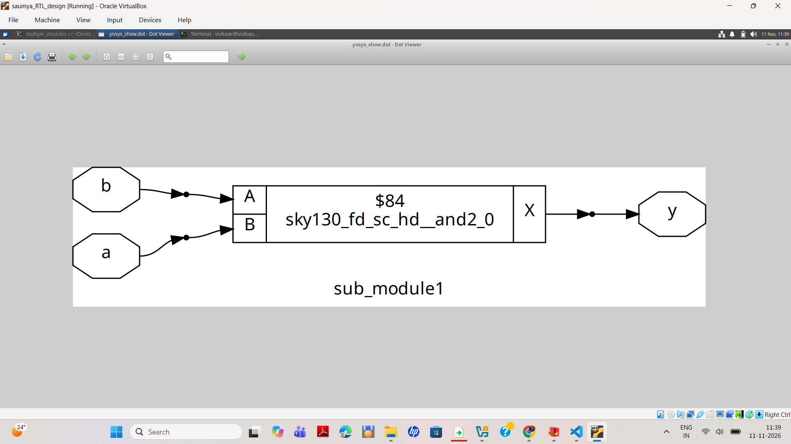
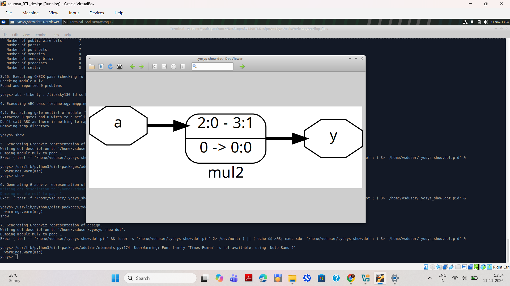

# Lab 2 — RTL Design, Simulation and Synthesis Using Sky130

## 1. Introduction

This lab focuses on Verilog RTL design, simulation, hierarchical synthesis, sequential circuits, and technology mapping using the Sky130 standard-cell library.

The practical exercises covered in this lab are:

1. Hierarchical design using multiple Verilog modules.
2. Asynchronous reset D Flip-Flop simulation and synthesis.
3. Asynchronous set D Flip-Flop simulation and synthesis.
4. Synchronous reset D Flip-Flop synthesis.
5. Multiplication by 2 using Verilog RTL and Yosys synthesis.

## 2. Tools and Environment

| Parameter | Details |
|---|---|
| Operating System | Ubuntu 24.04 LTS |
| Virtualization | Oracle VirtualBox |
| RTL Language | Verilog HDL |
| Simulation Tool | Icarus Verilog |
| Waveform Viewer | GTKWave |
| Synthesis Tool | Yosys 0.47+121 |
| Schematic Viewer | Graphviz / xdot |
| Technology Library | Sky130 HD |
| Liberty File | `sky130_fd_sc_hd__tt_025C_1v80.lib` |

### Repository Location

```bash
cd ~/Desktop/sky130RTLDesignAndSynthesisWorkshop/verilog_files
```

All commands are executed from the `verilog_files` directory unless mentioned otherwise.

---

# Experiment 1 — Hierarchical Design Using Multiple Modules

## 3. Objective

To understand hierarchical RTL design and how multiple Verilog modules are instantiated and connected to form a top-level design.

## 3.1 Verilog Design

The design contains three modules:

- `sub_module1`
- `sub_module2`
- `multiple_modules` (top module)

The output of the first submodule is connected to the second submodule through an intermediate signal called `net1`.

### RTL File: `multiple_modules.v`

```verilog
module sub_module2 (
    input a,
    input b,
    output y
);
    assign y = a | b;
endmodule

module sub_module1 (
    input a,
    input b,
    output y
);
    assign y = a & b;
endmodule

module multiple_modules (
    input a,
    input b,
    input c,
    output y
);

    wire net1;

    sub_module1 u1 (
        .a(a),
        .b(b),
        .y(net1)
    );

    sub_module2 u2 (
        .a(net1),
        .b(c),
        .y(y)
    );

endmodule
```

## 3.2 Functional Explanation

The first module performs an AND operation:

```verilog
assign y = a & b;
```

The second module performs an OR operation:

```verilog
assign y = a | b;
```

The intermediate signal `net1` connects the two modules.

Therefore:

\[
net1 = a \land b
\]

\[
y = net1 \lor c
\]

The final Boolean expression is:

\[
y = (a \land b) \lor c
\]

## 3.3 Yosys Synthesis Commands

Start Yosys from the terminal:

```bash
yosys
```

At the `yosys>` prompt, execute:

```tcl
read_verilog multiple_modules.v
hierarchy -top multiple_modules
synth -top multiple_modules
stat
show
```

## 3.4 Hierarchical Design Schematic



**Observation:**

- `sub_module1` receives inputs `a` and `b`.
- Its output is connected to `net1`.
- `sub_module2` receives `net1` and `c`.
- The final output is `y`.

This demonstrates hierarchical RTL design using module instantiation.

### Submodule 1



### Multiple Module Netlist


---

# Experiment 2 — Asynchronous Reset D Flip-Flop

## 4. Objective

To simulate and synthesize a D Flip-Flop with an asynchronous active-low reset.

## 4.1 RTL and Testbench Files

| File | Description |
|---|---|
| `dff_asyncres.v` | Asynchronous reset DFF RTL |
| `tb_dff_asyncres.v` | Testbench for simulation |

## 4.2 Simulation Commands

Compile the RTL and testbench in the Ubuntu terminal:

```bash
iverilog dff_asyncres.v tb_dff_asyncres.v
```

Run the simulation:

```bash
./a.out
```

Open the waveform:

```bash
gtkwave tb_dff_asyncres.vcd
```

## 4.3 Simulation Waveform


**Observed signals:**

- `clk` — Clock signal
- `async_reset` — Asynchronous reset
- `d` — Data input
- `q` — Registered output

**Observation:**

The asynchronous reset can reset the output independently of the active clock edge.

The simulation completed successfully, and the VCD file was generated.

Simulation completion:

```text
tb_dff_asyncres.v:24: $finish called at 3000000 (1ps)
```

## 4.4 Technology Mapping Using Sky130

Start Yosys:

```bash
yosys
```

At the `yosys>` prompt:

```tcl
read_liberty -lib ../lib/sky130_fd_sc_hd__tt_025C_1v80.lib
read_verilog dff_asyncres.v
hierarchy -top dff_asyncres
synth -top dff_asyncres
dfflibmap -liberty ../lib/sky130_fd_sc_hd__tt_025C_1v80.lib
abc -liberty ../lib/sky130_fd_sc_hd__tt_025C_1v80.lib
clean
stat
show
```

## 4.5 Mapped Schematic


**Mapped cells observed:**

- `sky130_fd_sc_hd__clkinv_1`
- `sky130_fd_sc_hd__dfrtp_1`

**Explanation:**

The reset input is inverted using a Sky130 inverter before connecting to the active-low reset pin (`RESET_B`) of the D Flip-Flop.

The D Flip-Flop stores the input data on the active clock edge.

---

# Experiment 3 — Asynchronous Set D Flip-Flop

## 5. Objective

To simulate and synthesize a D Flip-Flop with an asynchronous active-high set input.

## 5.1 RTL and Testbench Files

| File | Description |
|---|---|
| `dff_async_set.v` | Asynchronous set DFF RTL |
| `tb_dff_async_set.v` | Testbench for simulation |

## 5.2 Simulation Commands

Compile the design:

```bash
iverilog dff_async_set.v tb_dff_async_set.v
```

Run the simulation:

```bash
./a.out
```

Open the waveform:

```bash
gtkwave tb_dff_async_set.vcd
```

## 5.3 Simulation Waveform


**Observed signals:**

- `clk` — Clock
- `async_set` — Asynchronous set
- `d` — Data input
- `q` — Output

Simulation completion:

```text
tb_dff_async_set.v:25: $finish called at 3000000 (1ps)
```

**Observation:**

The asynchronous set input forces the output to its set state independently of the clock.

## 5.4 Technology Mapping Using Sky130

At the `yosys>` prompt:

```tcl
read_liberty -lib ../lib/sky130_fd_sc_hd__tt_025C_1v80.lib
read_verilog dff_async_set.v
hierarchy -top dff_async_set
synth -top dff_async_set
dfflibmap -liberty ../lib/sky130_fd_sc_hd__tt_025C_1v80.lib
abc -liberty ../lib/sky130_fd_sc_hd__tt_025C_1v80.lib
clean
stat
show
```

## 5.5 Mapped Schematic


**Mapped cells observed:**

- `sky130_fd_sc_hd__clkinv_1`
- `sky130_fd_sc_hd__dfstp_2`

**Observation:**

The asynchronous set input is inverted before connecting to the active-low set pin (`SET_B`) of the Sky130 D Flip-Flop.

---

# Experiment 4 — Synchronous Reset D Flip-Flop

## 6. Objective

To understand the synthesis implementation of a D Flip-Flop with synchronous reset.

## 6.1 Technology Mapping

The synchronous reset is evaluated as part of the clocked data path. Unlike asynchronous reset, it affects the stored output only at the active clock edge.

The mapped schematic shows reset logic connected to the D input of the flip-flop.

## 6.2 Yosys Commands

At the `yosys>` prompt:

```tcl
read_liberty -lib ../lib/sky130_fd_sc_hd__tt_025C_1v80.lib
read_verilog dff_syncres.v
hierarchy -top dff_syncres
synth -top dff_syncres
dfflibmap -liberty ../lib/sky130_fd_sc_hd__tt_025C_1v80.lib
abc -liberty ../lib/sky130_fd_sc_hd__tt_025C_1v80.lib
clean
stat
show
```

## 6.3 Mapped Schematic


**Mapped cells observed:**

- `sky130_fd_sc_hd__nor2b_1`
- `sky130_fd_sc_hd__dfrtp_1`

**Observation:**

The reset logic is implemented using a NOR-based gate in the data path, followed by the D Flip-Flop.

---

# Experiment 5 — Multiplication by 2 Using Verilog

## 7. Objective

To implement multiplication by 2 using Verilog RTL and understand how Yosys optimizes the operation during synthesis.

## 7.1 RTL Files

- `mult_2.v`
- `mult_8.v`

The files can be opened side by side using GVim.

### Bash Command

```bash
gvim mult_*.v -o
```

## 7.2 Verilog RTL — Multiplication by 2

File: `mult_2.v`

```verilog
module mul2 (
    input  [2:0] a,
    output [3:0] y
);

    assign y = a * 2;

endmodule
```

The design multiplies a 3-bit input by 2 and generates a 4-bit output.

## 7.3 Yosys Synthesis Commands

Start Yosys:

```bash
yosys
```

At the `yosys>` prompt:

```tcl
read_liberty -lib ../lib/sky130_fd_sc_hd__tt_025C_1v80.lib
read_verilog mult_2.v
hierarchy -top mul2
synth -top mul2
abc -liberty ../lib/sky130_fd_sc_hd__tt_025C_1v80.lib
show
```

## 7.4 Generated Schematic — First Result



## 7.5 Generated Schematic — Second Result


## 7.6 Synthesized Verilog Netlist

The generated netlist was saved as:

`mul2_netlist.v`

```verilog
module mul2(a, y);

    input [2:0] a;
    wire [2:0] a;

    output [3:0] y;
    wire [3:0] y;

    assign y = { a, 1'h0 };

endmodule
```

## 7.7 Understanding the Optimization

The original RTL operation is:

\[
y = a \times 2
\]

Multiplication by 2 is equivalent to shifting the input left by one bit:

\[
y = a \ll 1
\]

Therefore, Yosys optimizes the operation into a simple bit connection:

```verilog
assign y = { a, 1'h0 };
```

The output connections are:

| Output bit | Source |
|---|---|
| `y[3]` | `a[2]` |
| `y[2]` | `a[1]` |
| `y[1]` | `a[0]` |
| `y[0]` | `1'b0` |

### Example

For an input:

```text
a = 3'b101
```

The output is:

```text
y = 4'b1010
```

**Observation:**

The synthesis report shows zero logic cells because the optimized operation requires only wiring and a constant zero. ABC has no gates to map in this design.

---

# 8. Comparison of Reset Types

| Feature | Asynchronous Reset | Asynchronous Set | Synchronous Reset |
|---|---|---|---|
| Control operation | Reset | Set | Reset |
| Clock dependency | No | No | Yes |
| Output action | Clears output | Sets output | Clears output at active clock edge |
| Implementation observed | DFF with RESET_B | DFF with SET_B | Reset logic at D input |

---

# 9. Important Commands Summary

## Simulation — Bash Terminal

### Asynchronous Reset

```bash
iverilog dff_asyncres.v tb_dff_asyncres.v
./a.out
gtkwave tb_dff_asyncres.vcd
```

### Asynchronous Set

```bash
iverilog dff_async_set.v tb_dff_async_set.v
./a.out
gtkwave tb_dff_async_set.vcd
```

## Synthesis — Yosys

```tcl
read_liberty -lib ../lib/sky130_fd_sc_hd__tt_025C_1v80.lib
read_verilog <design_file.v>
hierarchy -top <top_module>
synth -top <top_module>
dfflibmap -liberty ../lib/sky130_fd_sc_hd__tt_025C_1v80.lib
abc -liberty ../lib/sky130_fd_sc_hd__tt_025C_1v80.lib
clean
stat
show
```

---

# 10. Conclusion

In this lab, different RTL structures were simulated and synthesized using open-source EDA tools.

The practical exercises demonstrated:

1. Hierarchical design and module instantiation in Verilog.
2. Functional simulation of asynchronous reset and set D Flip-Flops.
3. Technology mapping of sequential circuits using the Sky130 HD library.
4. Differences between synchronous and asynchronous reset behavior.
5. RTL optimization performed by Yosys.
6. Conversion of multiplication by 2 into a simple left-shift operation.

The lab provided practical experience with Verilog RTL, Icarus Verilog, GTKWave, Yosys, and Sky130 standard-cell technology mapping.
