# RTL Design and Synthesis Workshop Using SKY130

## Lab 5 – Day 5: Optimization in Synthesis

**Workshop:** RTL Design and Synthesis Workshop Using Sky130  
**Day:** 5  
**Lab:** 5  
**Technology:** SKY130  
**HDL:** Verilog  
**Simulation Tool:** Icarus Verilog  
**Waveform Viewer:** GTKWave  
**Synthesis Tool:** Yosys  

---

# 1. Introduction

The objective of this lab is to understand how different Verilog RTL coding styles affect hardware synthesis and optimization.

This lab covers:

- IF-ELSE constructs
- CASE constructs
- Incomplete assignments
- Latch inference
- RTL simulation
- Waveform analysis
- Synthesis and schematic visualization

# 2. Tools Used

| Tool | Purpose |
|---|---|
| GVim | RTL code editing |
| Icarus Verilog | RTL simulation |
| GTKWave | Waveform analysis |
| Yosys | Logic synthesis |
| Graphviz / xdot | Schematic visualization |
| SKY130 | Standard cell technology |

---

# 3. Experiment 1 – Incomplete IF Construct

## Objective

To understand how an incomplete IF statement in combinational logic can infer a latch during synthesis.

## Concept

In combinational logic, every output must be assigned for all possible input conditions.

If an output is not assigned in every branch, the previous value must be retained. This behavior results in latch inference.

## RTL Code (Illustrative Example)

```verilog
module incomp_if (
    input i0,
    input i1,
    input i2,
    output reg y
);

always @(*) begin
    if (i0)
        y = i1;
end

endmodule
```

## Synthesis Observation

**Top Module:** `incomp_if`

| Parameter | Observed Result |
|---|---:|
| Number of wires | 4 |
| Number of wire bits | 4 |
| Number of ports | 4 |
| Number of memories | 0 |
| Number of processes | 0 |
| Number of cells | 1 |
| Inferred cell | `$_DLATCH_P_` |

## Generated Schematic

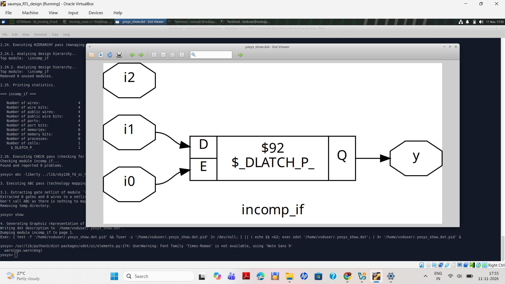

### Explanation

- i1 is connected to D (Data input).
- i0 controls E (Enable input).
- Q drives output y.
- i2 is an unused input.
- Yosys inferred a positive-level-sensitive D latch.

**Conclusion:** Incomplete assignments in combinational RTL can infer unintended latches.

## Simulation Waveform

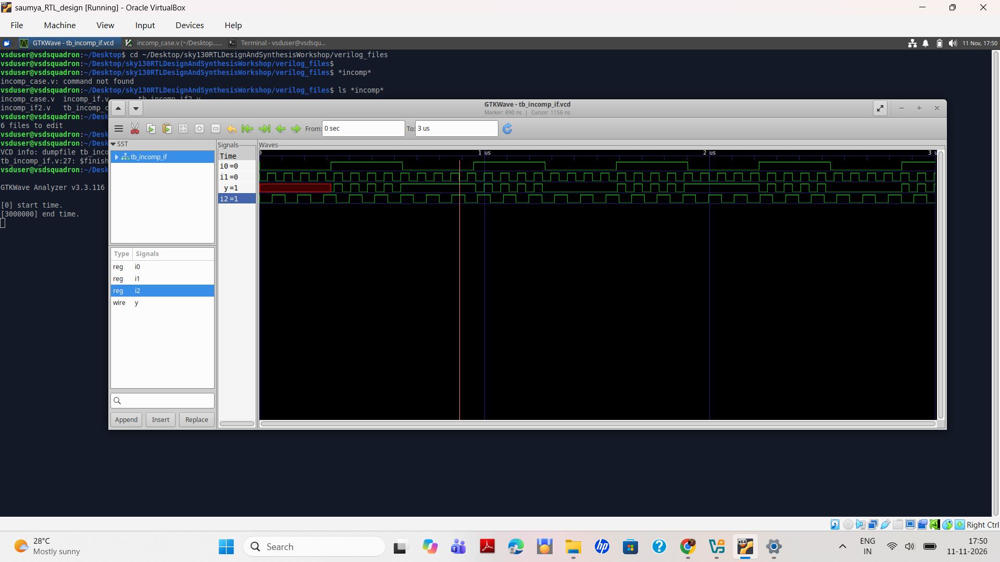

---

# 4. Experiment 2 – IF Construct Variations

Additional RTL examples were studied to understand conditional assignments and their synthesis implications.

## Incomplete IF – Second Example

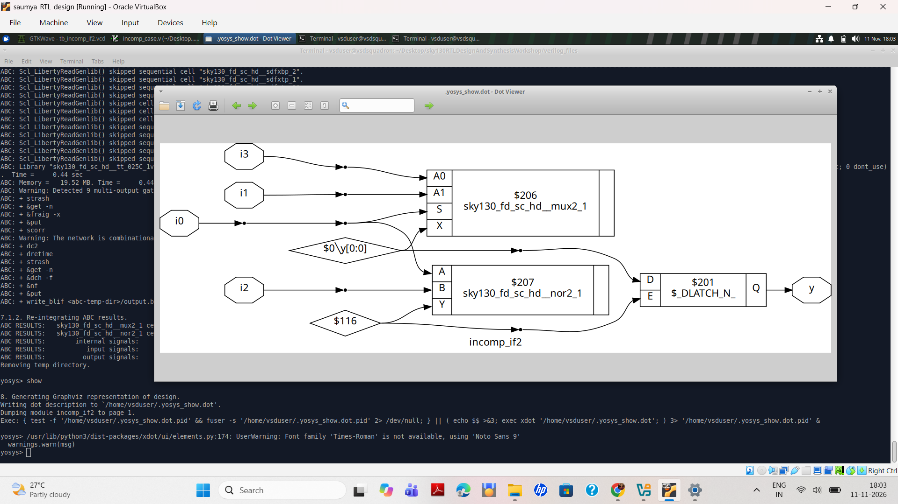

## Simulation Waveform

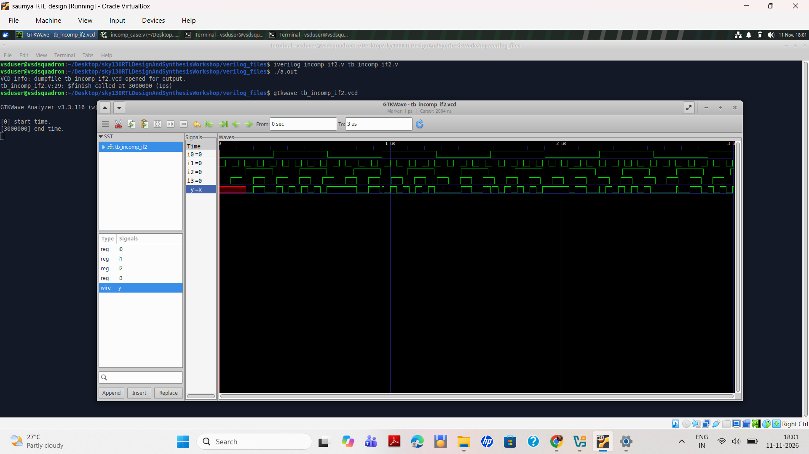

### Observation

Incomplete conditional assignments may cause the output to retain its previous value, resulting in latch inference.

---

# 5. Experiment 3 – CASE Constructs

## Objective

To understand the implementation of conditional logic using Verilog CASE statements.

## Concept

The CASE statement selects an output assignment based on the value of a selector signal.

## Example RTL Code

```verilog
always @(*) begin
    case (sel)
        2'b00: y = i0;
        2'b01: y = i1;
        2'b10: y = i2;
        2'b11: y = i3;
        default: y = 1'b0;
    endcase
end
```

## Complete CASE Schematic

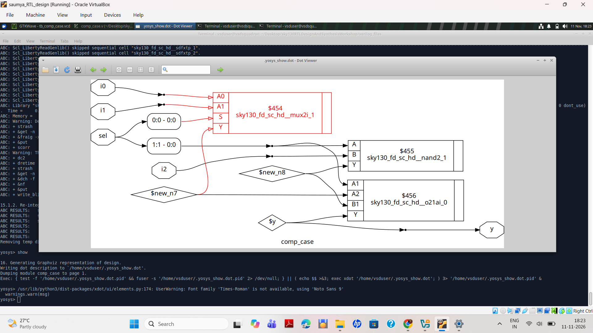

## Complete CASE Waveform

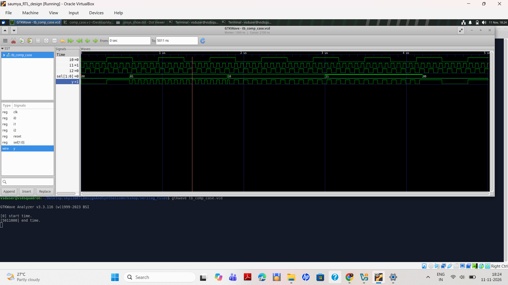

### Observation

A complete CASE statement assigns the output for every possible selector value, avoiding unintended latch inference in combinational logic.

---

# 6. Experiment 4 – Incomplete CASE Construct

## Objective

To study the effect of missing assignments in a Verilog CASE statement.

## Commands Executed

```bash
ls *case*

gvim comp_case.v -o incomp_case.v -o partial_case_assign.v -o bad_case.v

iverilog incomp_case.v tb_incomp_case.v

./a.out

gtkwave tb_incomp_case.vcd
```

## GTKWave Simulation Result

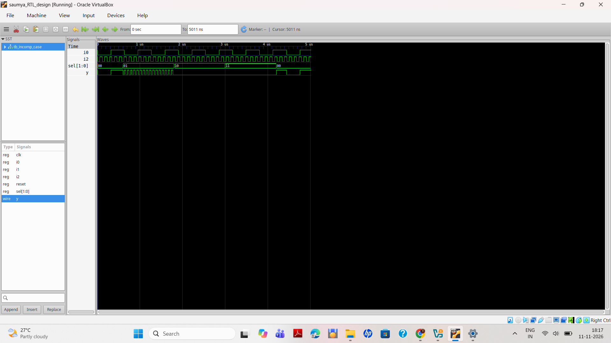

### Waveform Signals

- `i0` – Input signal
- `i2` – Input signal
- `sel[1:0]` – Selection signal
- `y` – Output signal

The select signal transitions through:

`00 → 01 → 10 → 11 → 00`

### Observation

The output waveform shows transitions and repeated narrow pulses during part of the `10` selection interval.

Incomplete CASE assignments can result in latch inference.

---

# 7. Experiment 5 – CASE Construct Variations

The following RTL files were opened together for comparison.

```bash
gvim comp_case.v -o incomp_case.v -o partial_case_assign.v -o bad_case.v
```

## RTL Files

| File | Description |
|---|---|
| `comp_case.v` | Complete CASE assignment |
| `incomp_case.v` | Incomplete CASE assignment |
| `partial_case_assign.v` | Partial CASE assignment |
| `bad_case.v` | Alternative CASE coding example |

## Bad CASE Waveform

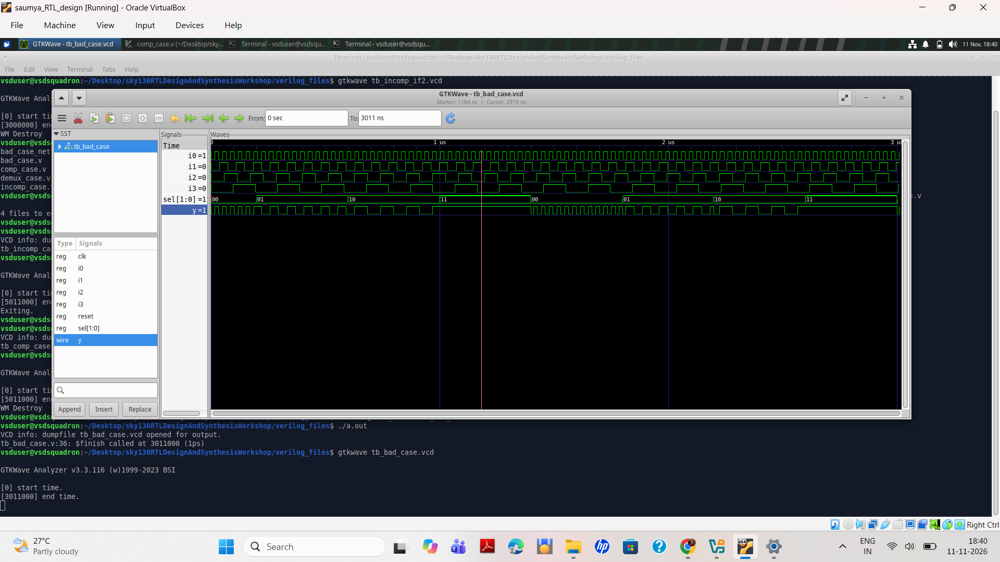

## Bad CASE Testbench Waveform

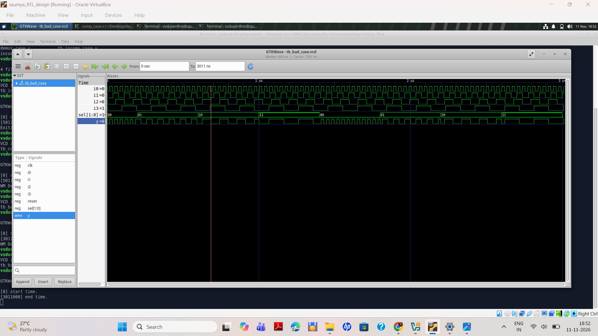

---

# 8. Additional Uploaded Waveforms

## Demultiplexer

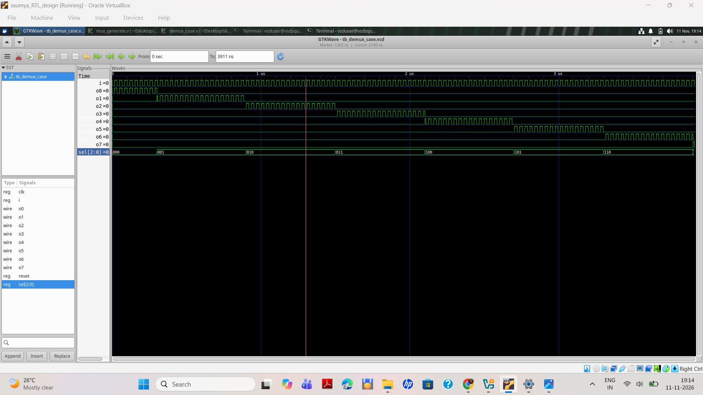

## Multiplexer

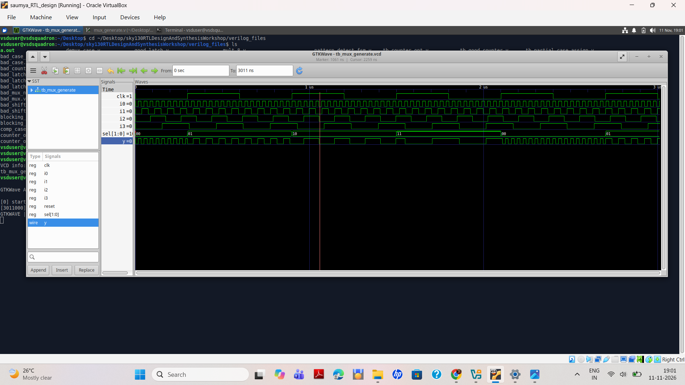
## Ripple Carry Adder

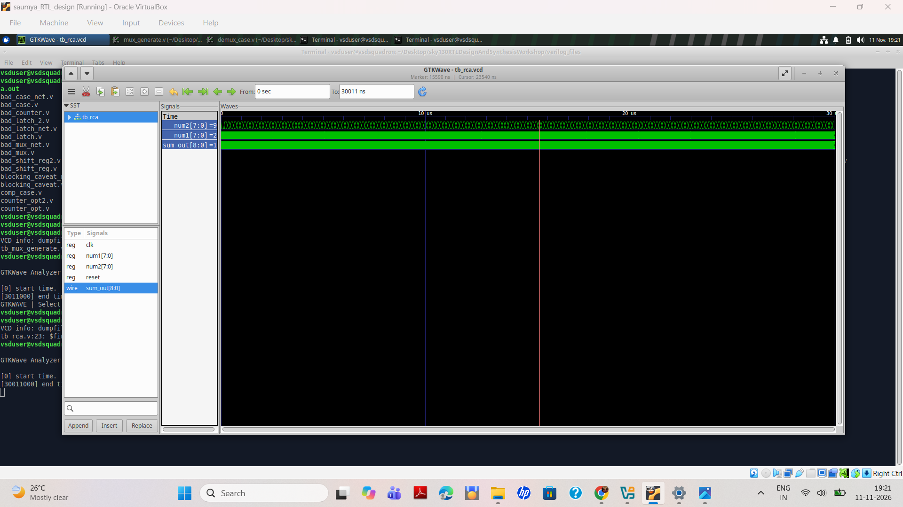

---

# 9. Simulation Commands

## Compile Verilog Code

```bash
iverilog design.v testbench.v
```

## Execute Simulation

```bash
./a.out
```

## View Waveform

```bash
gtkwave testbench.vcd
```

---

# 10. Yosys Synthesis Commands

```tcl
read_verilog design.v
synth -top module_name
stat
show
```

---

# 11. Key Learnings

1. Incomplete IF statements can infer latches.
2. Incomplete CASE assignments can also infer latches.
3. Complete assignments are essential for combinational logic.
4. RTL coding style directly affects synthesis results.
5. Simulation helps verify functional behavior.
6. Yosys identifies inferred hardware through synthesis statistics and schematics.
7. Understanding latch inference is important for RTL design and optimization.

---

# 12. Next Topic – FOR Loop and FOR Generate

**Workshop Section:** SKY130RTL D5SK4  
**Lesson:** For Loop and For Generate – Part 1

### Topics to be covered

- Procedural FOR loop
- Generate and Endgenerate
- Genvar
- Difference between FOR loop and FOR generate
- Hardware generation during synthesis

Practical implementation and results will be documented separately.

---

# 13. Conclusion

Lab 5 demonstrates the impact of Verilog coding styles on hardware synthesis.

Through IF and CASE constructs, RTL simulation, waveform analysis, and Yosys synthesis, the experiments provide practical understanding of latch inference and combinational logic design.

Writing complete and synthesis-friendly RTL code is essential for reliable digital hardware design.

---

**Repository:** RTL Design and Synthesis Workshop Using SKY130  
**Lab:** 05 – Optimization in Synthesis
