# LAB 3 – Combinational and Sequential Logic Optimizations

**Workshop:** RTL Design and Synthesis Workshop Using Sky130  
**Day:** 3  
**Technology:** SkyWater SKY130  
**RTL Language:** Verilog HDL  
**Synthesis Tool:** Yosys  
**Logic Optimization:** ABC  
**Simulation:** Icarus Verilog and GTKWave  

---

# 1. Introduction

The objective of this lab is to understand combinational and sequential logic optimization techniques using Verilog HDL.

The experiments demonstrate how RTL coding styles affect synthesis, logic optimization, hardware implementation, and technology mapping using the Sky130 standard cell library.

## Tools Used

| Tool | Purpose |
|---|---|
| Ubuntu | Linux development environment |
| GVim | Verilog code editing |
| Icarus Verilog | RTL simulation |
| GTKWave | Waveform analysis |
| Yosys | RTL synthesis |
| ABC | Logic optimization |
| Sky130 HD | Standard cell library |
| Graphviz / Xdot | Schematic visualization |

---

# PART A – COMBINATIONAL LOGIC OPTIMIZATION

## 2. Experiment 1 – opt_check

### Concept

An AND gate is a combinational logic circuit. Its output is HIGH only when all inputs are HIGH.

**Boolean Expression:**

Y = A · B

### Commands

```bash
ls *opt*
ls *opt_check*
yosys
```

### Yosys Synthesis

```tcl
read_liberty -lib ../lib/sky130_fd_sc_hd__tt_025C_1v80.lib
read_verilog opt_check.v
synth -top opt_check
opt_clean -purge
abc -liberty ../lib/sky130_fd_sc_hd__tt_025C_1v80.lib
show
```

### Observation

The design was mapped to:

`sky130_fd_sc_hd__and2_0`

This standard cell implements a two-input AND gate.

### Schematic

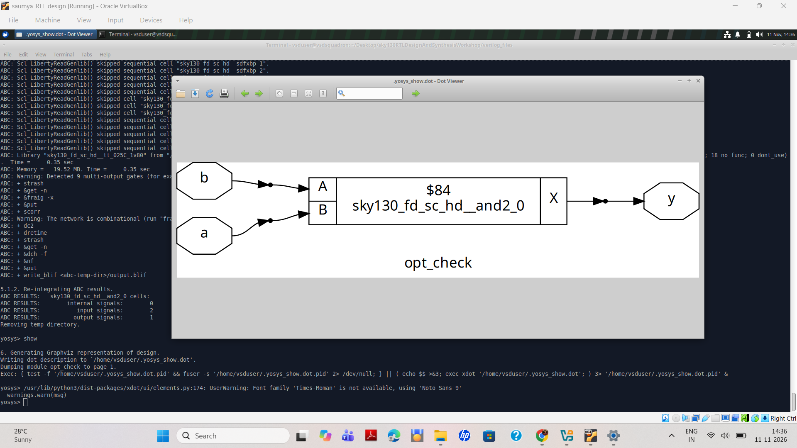

---

## 3. Experiment 2 – opt_check2

### Concept

An OR gate produces a HIGH output when at least one input is HIGH.

**Boolean Expression:**

Y = A + B

### Commands

```tcl
read_verilog opt_check2.v
synth -top opt_check2
opt_clean -purge
abc -liberty ../lib/sky130_fd_sc_hd__tt_025C_1v80.lib
show
```

### Observation

The design was mapped to:

`sky130_fd_sc_hd__or2_0`

The circuit contains two input signals (a, b) and one output (y).

### Schematic

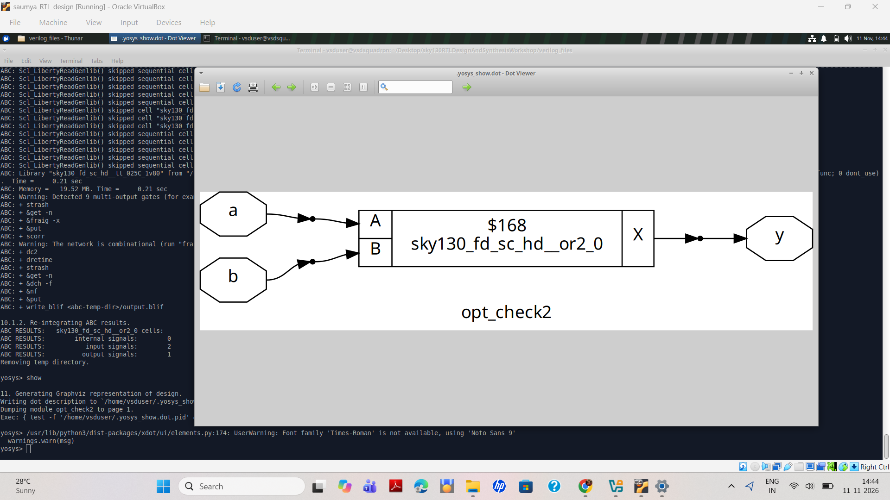

---

## 4. Experiment 3 – opt_check3

### Concept

A three-input AND gate produces HIGH only when all three inputs are HIGH.

**Boolean Expression:**

Y = A · B · C

### Commands

```tcl
read_verilog opt_check3.v
synth -top opt_check3
opt_clean -purge
abc -liberty ../lib/sky130_fd_sc_hd__tt_025C_1v80.lib
show
```

### Observation

The design was mapped to:

`sky130_fd_sc_hd__and3_1`

The circuit contains three inputs (a, b, c) and one output (y).

### Schematic

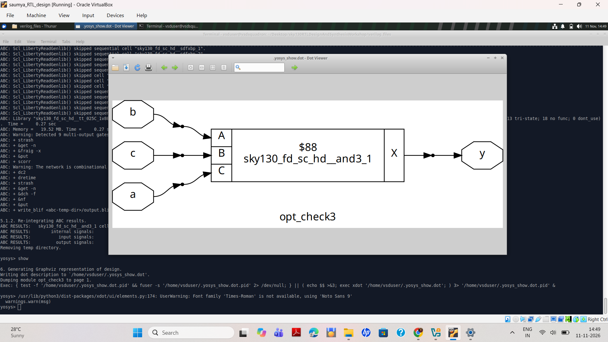

---

## 5. Experiment 4 – opt_check4

### Objective

To study another combinational optimization example and observe how Yosys performs logic synthesis and technology mapping.

### Schematic

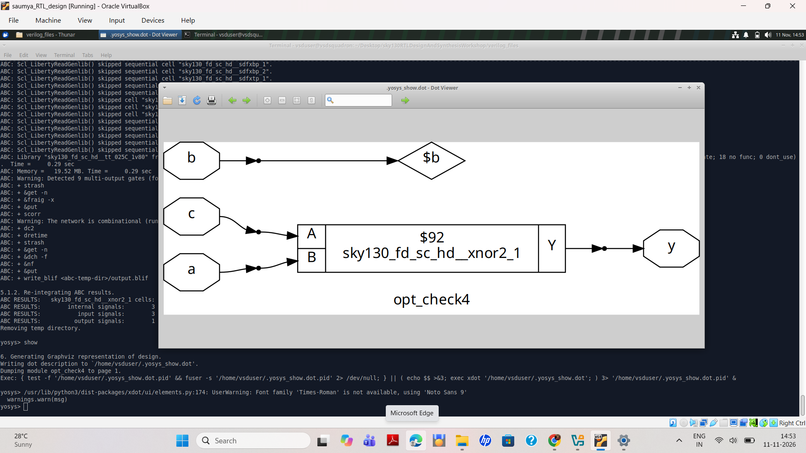

---

## 6. Experiment 5 – Multiple Module Optimization

### Concept

Hierarchical RTL design divides a complex design into smaller reusable modules.

A top-level module can instantiate multiple submodules to implement the required functionality.

### Submodule RTL

```verilog
module sub_module(input a, input b, output y);

assign y = a & b;

endmodule
```

### Top-Level Module

```verilog
module multiple_module_opt2(
    input a, input b, input c, input d,
    output y
);

wire n1, n2, n3;

sub_module U1 (.a(a),  .b(1'b0), .y(n1));
sub_module U2 (.a(b),  .b(c),    .y(n2));
sub_module U3 (.a(n2), .b(d),    .y(n3));
sub_module U4 (.a(n3), .b(n1),   .y(y));

endmodule
```

### Yosys Commands

```tcl
read_liberty -lib ../lib/sky130_fd_sc_hd__tt_025C_1v80.lib
read_verilog multiple_module_opt2.v
hierarchy -top multiple_module_opt2
synth -top multiple_module_opt2
opt_clean -purge
abc -liberty ../lib/sky130_fd_sc_hd__tt_025C_1v80.lib
stat -liberty ../lib/sky130_fd_sc_hd__tt_025C_1v80.lib
```

### Schematic Visualization

```tcl
select -module multiple_module_opt2
show
```

### Observation

Yosys identified:

- Top module: `multiple_module_opt2`
- Submodule: `sub_module`

The hierarchy pass analyzed the module instances and their connections.

### Schematic

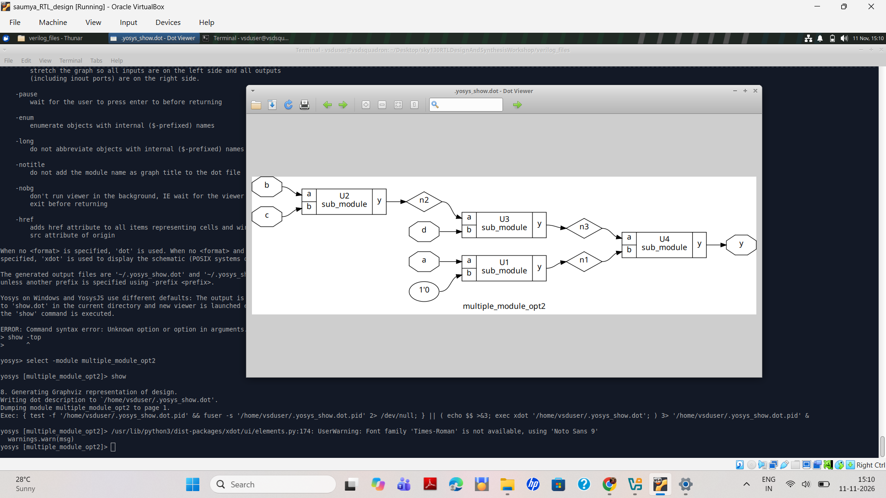

---

# PART B – SEQUENTIAL LOGIC OPTIMIZATION

## 7. Experiment 6 – DFF with Constant Input (dff_const1)

### Concept

A D Flip-Flop is a sequential circuit that stores one bit of information.

Its output depends on the clock edge, input data, and reset condition.

In this experiment, the D input is connected to a constant logic HIGH.

### Verilog Files

- `dff_const1.v`
- `dff_const2.v`
- `tb_dff_const1.v`

### Commands

```bash
ls *dff*
ls *df*const*
gvim dff_const1.v -o dff_const2.v
iverilog dff_const1.v tb_dff_const1.v
./a.out
gtkwave tb_dff_const1.vcd
```

### Waveform Observation

The GTKWave simulation displays:

- `clk` – Clock signal
- `reset` – Reset signal
- `q` – Output signal

The output initially remains LOW during reset. After reset deassertion, the output becomes HIGH following the active clock edge.

### Simulation Waveform

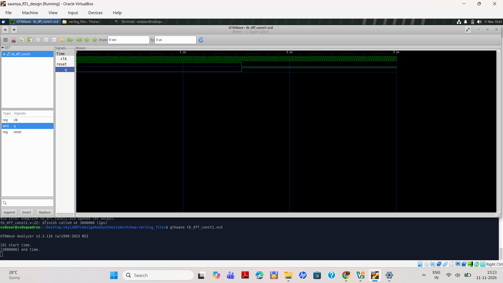

### Yosys Synthesis

```tcl
read_liberty -lib ../lib/sky130_fd_sc_hd__tt_025C_1v80.lib
read_verilog dff_const1.v
synth -top dff_const1
dfflibmap -liberty ../lib/sky130_fd_sc_hd__tt_025C_1v80.lib
abc -liberty ../lib/sky130_fd_sc_hd__tt_025C_1v80.lib
show
```

### Technology Mapping

Mapped cells observed:

1. `sky130_fd_sc_hd__dfrtp_1`
2. `sky130_fd_sc_hd__clkinv_1`

**Explanation:**

- `dfrtp_1` – Positive-edge-triggered D flip-flop with active-low asynchronous reset.
- `clkinv_1` – Inverter used for reset polarity conversion.
- D input – Connected to constant logic HIGH.

### Synthesized Schematic

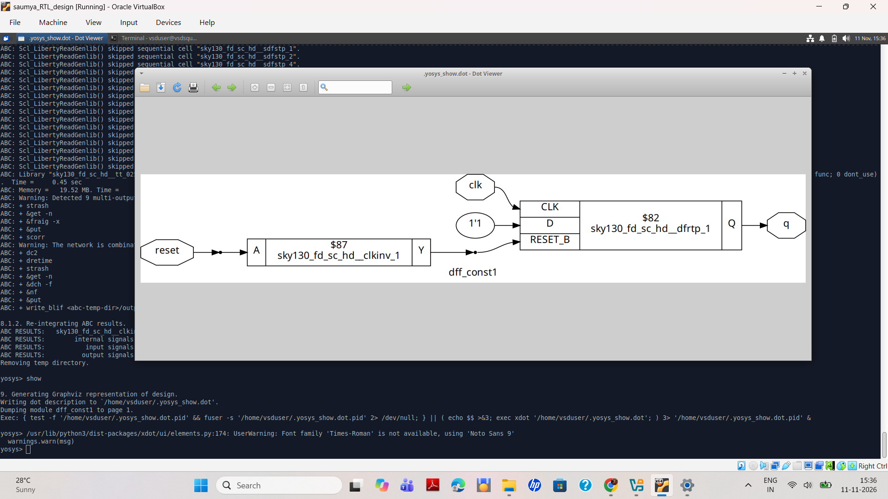

---

## 8. Experiment 7 – DFF Constant Optimization (Additional Cases)

### Objective

To study different DFF constant-input RTL implementations and understand how synthesis handles constant signals and sequential elements.

### DFF Constant 2

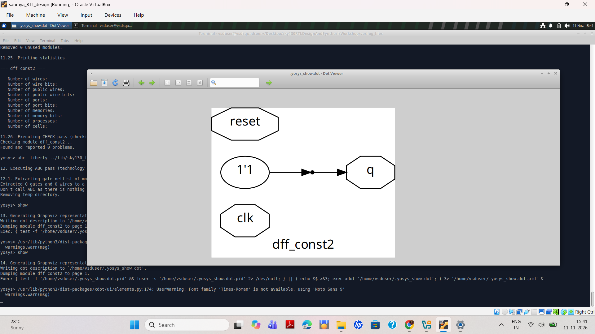

### DFF Constant 3 – Simulation Waveform

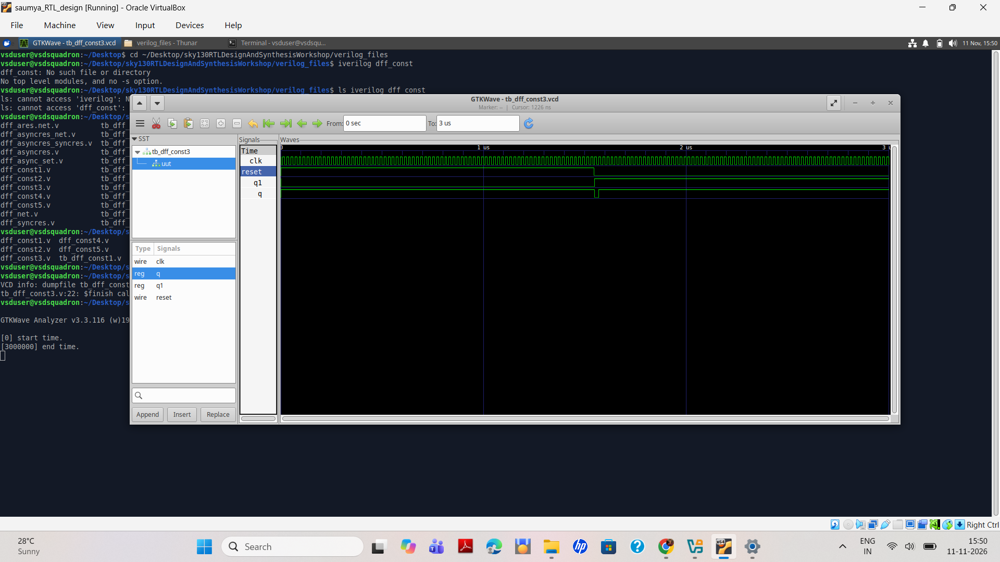

### DFF Constant 4

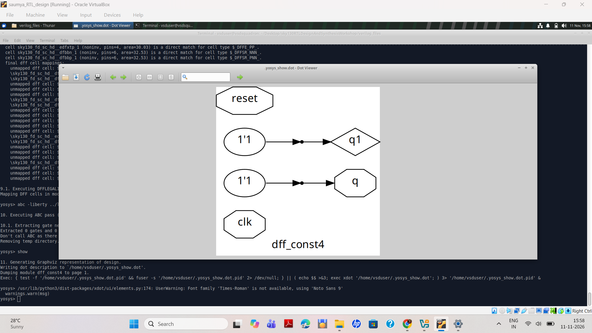

### DFF Constant 5

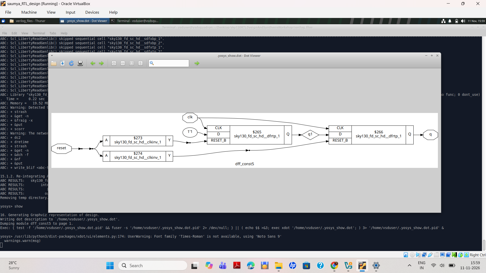

**Observation:** Different sequential RTL descriptions can produce different synthesized circuit structures. The mapped cells should be compared using Yosys statistics.

---

## 9. Experiment 8 – Counter Optimization (counter_opt)

### Concept

A counter is a sequential circuit that stores and updates its binary state on every active clock edge.

A 3-bit counter can represent values from 0 to 7. After reaching 7, it wraps around to 0.

### Verilog RTL

```verilog
module counter_opt (
    input clk,
    input reset,
    output q
);

reg [2:0] count;

assign q = (count[2:0] == 3'b100);

always @(posedge clk, posedge reset)
begin
    if (reset)
        count <= 3'b000;
    else
        count <= count + 1;
end

endmodule
```

### Code Explanation

- `reg [2:0] count` declares a 3-bit counter register.
- `posedge clk` triggers the counter on the rising clock edge.
- `posedge reset` provides asynchronous reset.
- When reset is HIGH, the counter is cleared to zero.
- Otherwise, the counter increments by one.
- Output q becomes HIGH when count reaches binary `100`.

### Yosys Commands

```tcl
read_liberty -lib ../lib/sky130_fd_sc_hd__tt_025C_1v80.lib
read_verilog counter_opt.v
synth -top counter_opt
dfflibmap -liberty ../lib/sky130_fd_sc_hd__tt_025C_1v80.lib
abc -liberty ../lib/sky130_fd_sc_hd__tt_025C_1v80.lib
opt_clean -purge
stat -liberty ../lib/sky130_fd_sc_hd__tt_025C_1v80.lib
show
```

### Observation

The synthesized design contains sequential flip-flops and combinational logic for counter incrementing and output comparison.

### Schematic

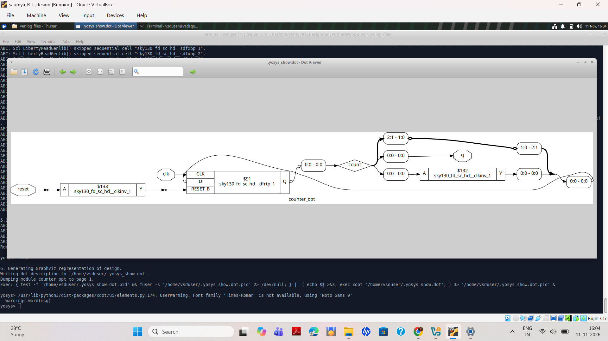

---

## 10. Experiment 9 – Modified Counter Optimization (counter_opt2)

### Objective

To simplify the output logic of the original counter and observe the effect of RTL modification on synthesized hardware.

### Step 1 – Copy the Original RTL

```bash
gvim counter_opt.v
cp counter_opt.v counter_opt2.v
gvim counter_opt2.v
```

### Step 2 – Original Output Logic

```verilog
assign q = (count[2:0] == 3'b100);
```

This expression checks whether the counter has reached decimal 4.

### Step 3 – Modified Output Logic

```verilog
assign q = count[0];
```

The modified design directly connects the least significant bit (LSB) of the counter to output q.

### Step 4 – Synthesis Commands

```tcl
read_liberty -lib ../lib/sky130_fd_sc_hd__tt_025C_1v80.lib
read_verilog counter_opt2.v
synth -top counter_opt
dfflibmap -liberty ../lib/sky130_fd_sc_hd__tt_025C_1v80.lib
abc -liberty ../lib/sky130_fd_sc_hd__tt_025C_1v80.lib
opt_clean -purge
stat -liberty ../lib/sky130_fd_sc_hd__tt_025C_1v80.lib
show
```

**Note:** The modified file retains the module name `counter_opt`, so the synthesis top is `counter_opt`.

### Optimization Explanation

The original design uses a three-bit equality comparator to detect a particular counter state.

The modified design directly connects the LSB to the output, removing the equality-comparison logic from the output path.

### Functional Comparison

| Count | Binary | Original q | Modified q |
|---|---|---:|---:|
| 0 | 000 | 0 | 0 |
| 1 | 001 | 0 | 1 |
| 2 | 010 | 0 | 0 |
| 3 | 011 | 0 | 1 |
| 4 | 100 | 1 | 0 |
| 5 | 101 | 0 | 1 |
| 6 | 110 | 0 | 0 |
| 7 | 111 | 0 | 1 |

### Modified Counter Schematic

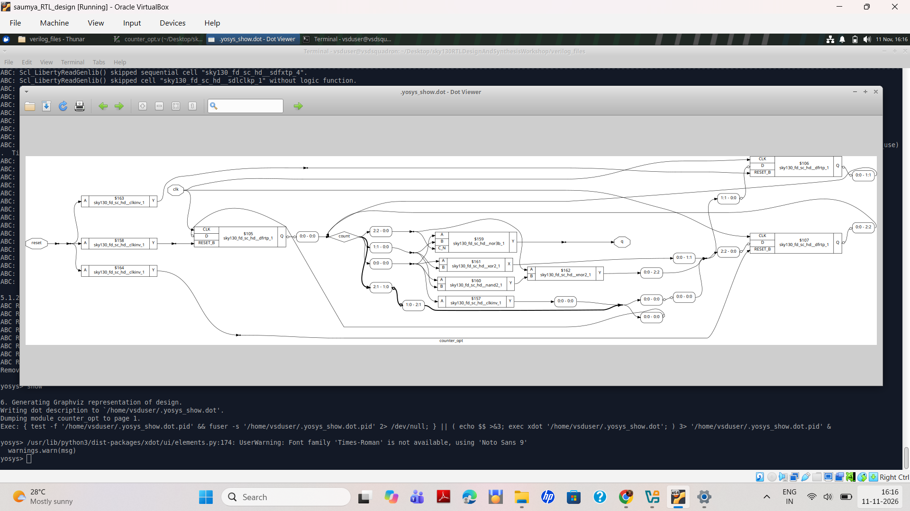

---

# 11. Key Learning Outcomes

1. Combinational logic optimization.
2. Boolean logic implementation.
3. Standard cell technology mapping.
4. Hierarchical RTL design.
5. Sequential logic optimization.
6. D Flip-Flop behavior and reset handling.
7. DFF technology mapping using `dfflibmap`.
8. Counter design and optimization.
9. RTL coding styles and hardware complexity.
10. Yosys synthesis and ABC optimization.
11. Schematic analysis using Graphviz and Xdot.

---

# 12. Conclusion

This lab provided practical experience in combinational and sequential logic optimization using Verilog HDL, Yosys, ABC, and the Sky130 HD standard cell library.

The combinational experiments covered AND, OR, multi-input logic, and hierarchical module design.

The sequential experiments focused on DFF constant inputs, flip-flop technology mapping, counter implementation, and RTL modification.

The counter optimization experiment demonstrated how modifying RTL output logic can eliminate unnecessary combinational comparison logic.

Overall, this lab strengthened the understanding of RTL synthesis, logic optimization, sequential circuits, and standard cell technology mapping.

---

**Repository:** RTL Design and Synthesis Workshop Using Sky130  
**Lab:** 3 – Combinational and Sequential Logic Optimizations
