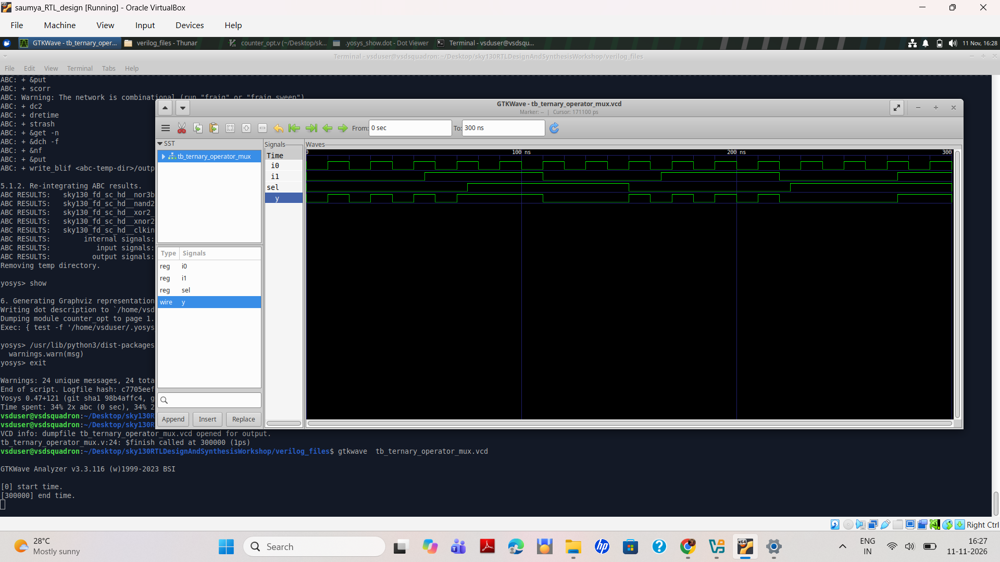
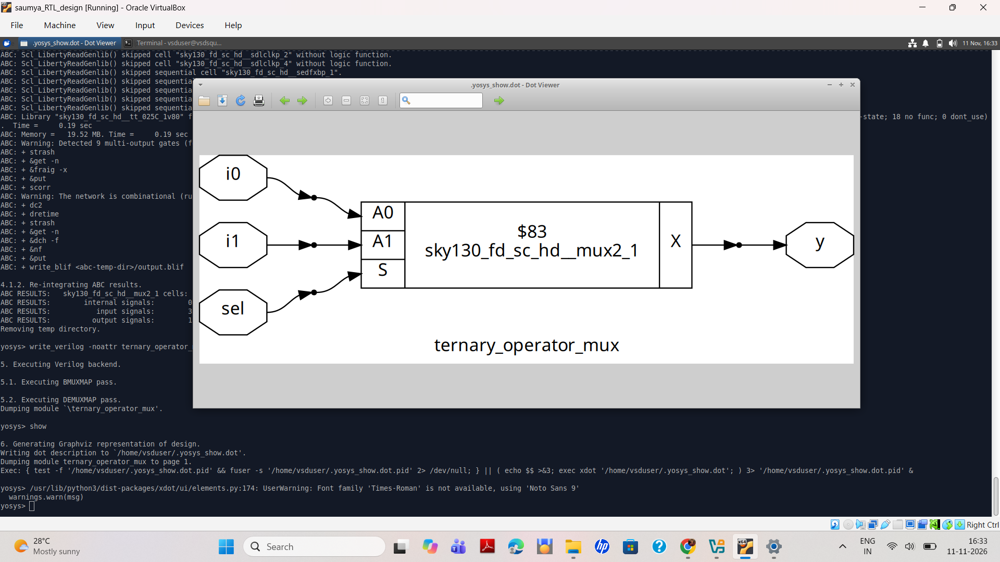
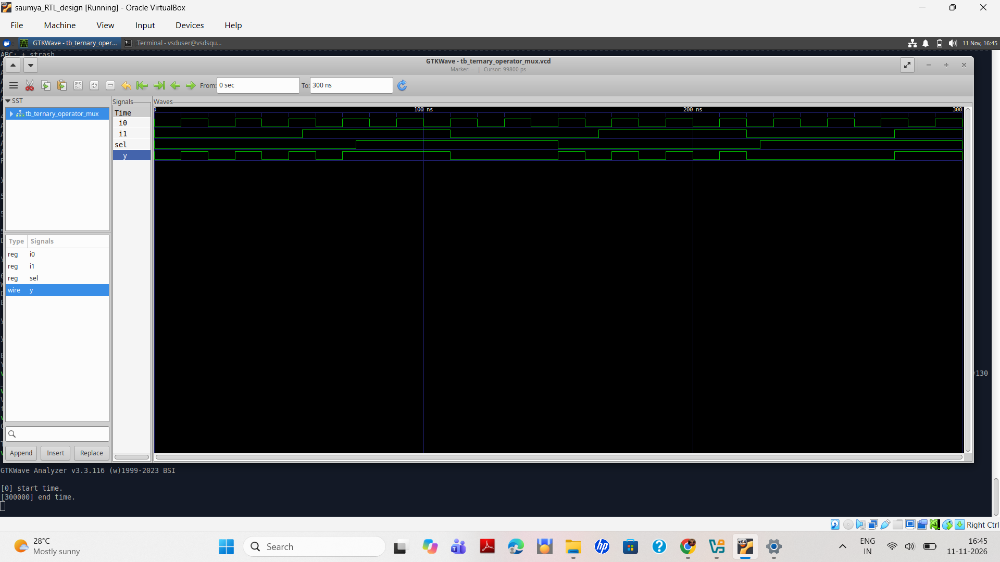
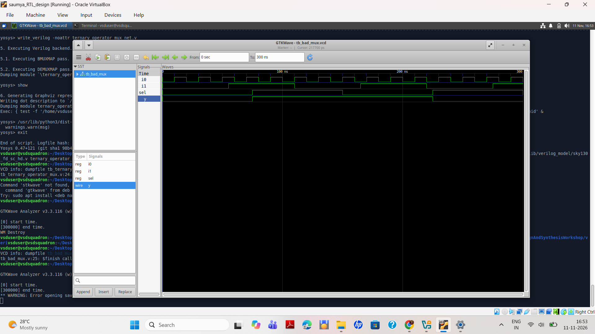
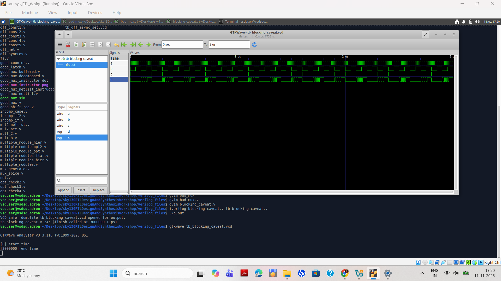
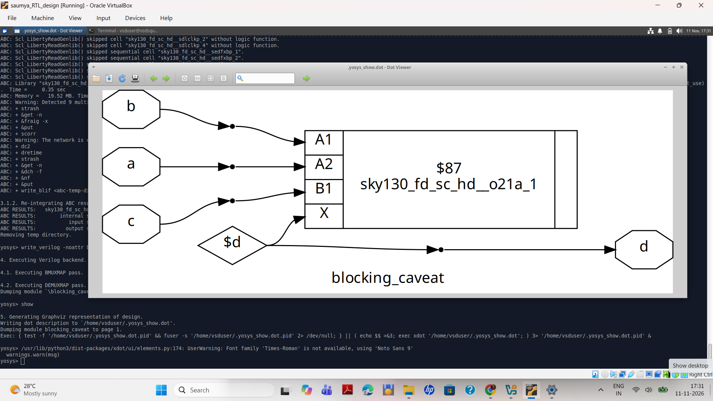
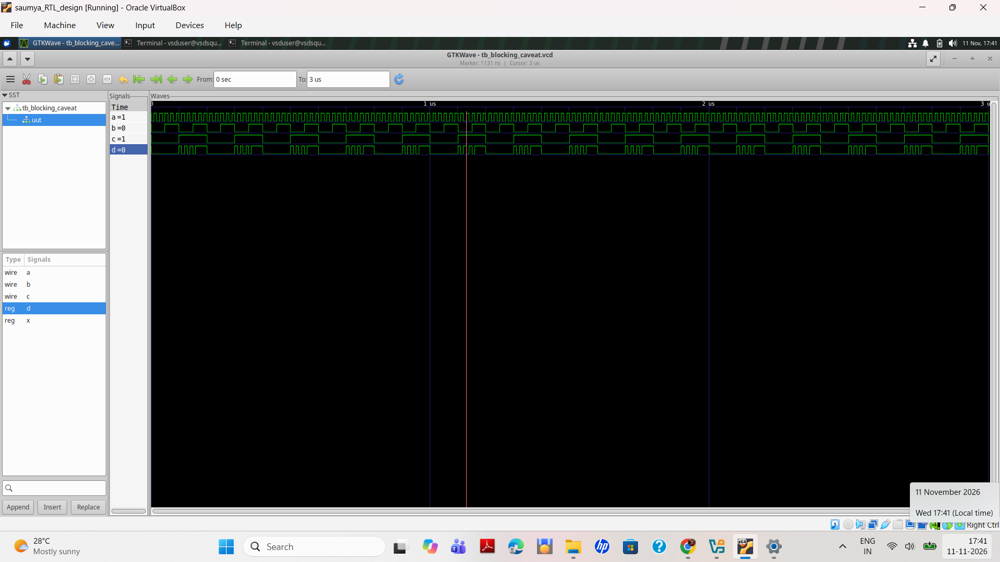

# LAB 4 – GLS, Blocking vs Non-Blocking and Synthesis-Simulation Mismatch

## RTL Design and Synthesis Workshop Using Sky130

**Day 4 | Lab 4**

---

## 1. Objective

The objective of this lab is to understand:

- Gate-Level Simulation (GLS) using Icarus Verilog.
- RTL Simulation and Synthesis flow.
- Ternary Operator implementation using a 2:1 Multiplexer.
- Blocking and Non-Blocking assignments.
- Incomplete sensitivity list in combinational logic.
- Synthesis-Simulation mismatch.
- Technology mapping using Sky130 standard-cell library.

## 2. Tools Used

| Tool | Purpose |
|---|---|
| Icarus Verilog | RTL and GLS Simulation |
| GTKWave | Waveform Analysis |
| Yosys | RTL Synthesis |
| ABC | Technology Mapping |
| Sky130 PDK | Standard Cell Library |
| Graphviz | Circuit Visualization |

---

# EXPERIMENT 1 – Ternary Operator MUX

## 1.1 Objective

To implement a 2:1 Multiplexer using the Verilog ternary operator and verify its functionality through RTL simulation and synthesis.

## 1.2 RTL Code

**File: `ternary_operator_mux.v`**

```verilog
module ternary_operator_mux (
    input i0,
    input i1,
    input sel,
    output y
);

assign y = sel ? i1 : i0;

endmodule
```

## 1.3 Explanation

The ternary operator implements a 2:1 multiplexer.

- When `sel = 0`, output `y = i0`.
- When `sel = 1`, output `y = i1`.

**Boolean Expression:**

Y = (~sel & i0) | (sel & i1)

## 1.4 RTL Simulation

**Commands:**

```bash
iverilog ternary_operator_mux.v tb_ternary_operator_mux.v
./a.out
gtkwave tb_ternary_operator_mux.vcd
```

**RTL Simulation Waveform:**



## 1.5 Yosys Synthesis

**Commands:**

```tcl
read_liberty -lib ../lib/sky130_fd_sc_hd__tt_025C_1v80.lib
read_verilog ternary_operator_mux.v
synth -top ternary_operator_mux
abc -liberty ../lib/sky130_fd_sc_hd__tt_025C_1v80.lib
write_verilog -noattr ternary_operator_mux_net.v
show
```

**Synthesized Schematic:**



### Synthesis Observation

The RTL design was mapped into a single Sky130 standard cell:

`sky130_fd_sc_hd__mux2_1`

| Parameter | Result |
|---|---|
| Number of cells | 1 |
| Standard cell | mux2_1 |
| Input signals | 3 |
| Output signals | 1 |

## 1.6 Gate-Level Simulation (GLS)

GLS verifies the synthesized gate-level netlist using Sky130 Verilog models and the testbench.

**Compilation:**

```bash
iverilog ../my_lib/verilog_model/primitives.v ../my_lib/verilog_model/sky130_fd_sc_hd.v ternary_operator_mux_net.v tb_ternary_operator_mux.v
```

**Run Simulation:**

```bash
./a.out
```

**Open Waveform:**

```bash
gtkwave tb_ternary_operator_mux.vcd
```

**GLS Waveform:**



### Result

The ternary operator MUX was successfully simulated and synthesized. Yosys and ABC mapped the design into a Sky130 `mux2_1` standard cell.

---

# EXPERIMENT 2 – Bad MUX (Incomplete Sensitivity List)

## 2.1 Objective

To understand the simulation-synthesis mismatch caused by an incomplete sensitivity list in a combinational always block.

## 2.2 RTL Code

**File: `bad_mux.v`**

```verilog
module bad_mux (
    input i0,
    input i1,
    input sel,
    output reg y
);

always @(sel)
begin
    if (sel)
        y = i1;
    else
        y = i0;
end

endmodule
```

## 2.3 Explanation

Only `sel` is included in the sensitivity list.

When `i0` or `i1` changes while `sel` remains constant, the always block does not execute again.

Consequently, the output may retain its previous value instead of updating according to the selected input.

This demonstrates the simulation hazard caused by an incomplete sensitivity list.

## 2.4 Simulation Commands

```bash
iverilog bad_mux.v tb_bad_mux.v
./a.out
gtkwave tb_bad_mux.vcd
```

## 2.5 Simulation Waveform



### Result

The experiment demonstrates how an incomplete sensitivity list can cause incorrect RTL simulation behavior.

---

# EXPERIMENT 3 – Blocking vs Non-Blocking Assignments

## 3.1 Objective

To understand the difference between blocking (`=`) and non-blocking (`<=`) assignments in Verilog.

## 3.2 Blocking Assignment

Blocking assignments execute immediately and sequentially within a procedural block.

**Example:**

```verilog
always @(*)
begin
    a = b;
    c = a;
end
```

The second statement uses the updated value of `a`.

## 3.3 Non-Blocking Assignment

Non-blocking assignments schedule updates for the end of the current simulation time step.

**Example:**

```verilog
always @(posedge clk)
begin
    a <= b;
    c <= a;
end
```

Here, `c` receives the previous value of `a`.

## 3.4 Difference Between Blocking and Non-Blocking

| Blocking (`=`) | Non-Blocking (`<=`) |
|---|---|
| Executes immediately | Schedules updates |
| Statements execute sequentially | Updates occur later |
| Commonly used in combinational logic | Commonly used in sequential logic |
| Can cause race conditions if used carelessly | Helps model clocked registers correctly |

## 3.5 Simulation Waveform



### Result

The experiment illustrates the different simulation semantics of blocking and non-blocking assignments.

---

# EXPERIMENT 4 – Blocking Caveat and Synthesis-Simulation Mismatch

## 4.1 Objective

To understand the potential simulation-synthesis mismatch and race conditions associated with blocking assignments in sequential logic.

## 4.2 Concept

Blocking assignments update variables immediately within the executing procedural block.

When multiple clocked always blocks interact, simulation behavior can depend on the execution order of the blocks.

This may result in race conditions and simulation mismatches.

## 4.3 Synthesized Circuit



## 4.4 Simulation Waveform



## 4.5 Key Learning

- Blocking assignments execute immediately.
- Non-blocking assignments schedule updates.
- Blocking assignments in interacting sequential blocks can cause race conditions.
- Non-blocking assignments are generally preferred for clocked sequential logic.

### Result

The experiment demonstrates the importance of understanding Verilog scheduling semantics and selecting appropriate assignment types for sequential logic.

---

# OVERALL LAB 4 CONCLUSION

In this lab, the following concepts were studied:

1. Implemented a 2:1 MUX using the ternary operator.
2. Performed RTL simulation using Icarus Verilog.
3. Synthesized the RTL design using Yosys.
4. Performed technology mapping using ABC and Sky130 HD library.
5. Analyzed the synthesized circuit using Graphviz.
6. Studied Gate-Level Simulation using Sky130 Verilog models.
7. Investigated incomplete sensitivity lists.
8. Studied blocking and non-blocking assignments.
9. Understood simulation-synthesis mismatch and race conditions.

**Key Learning:**

Writing functionally correct RTL is not sufficient. Understanding simulation semantics, synthesis behavior, technology mapping and gate-level verification is equally important in digital design.

---

**Workshop:** RTL Design and Synthesis Using Sky130

**Lab:** 4

**Focus:** GLS, Blocking vs Non-Blocking and Synthesis-Simulation Mismatch

