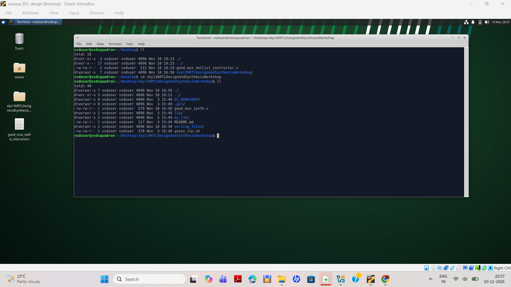
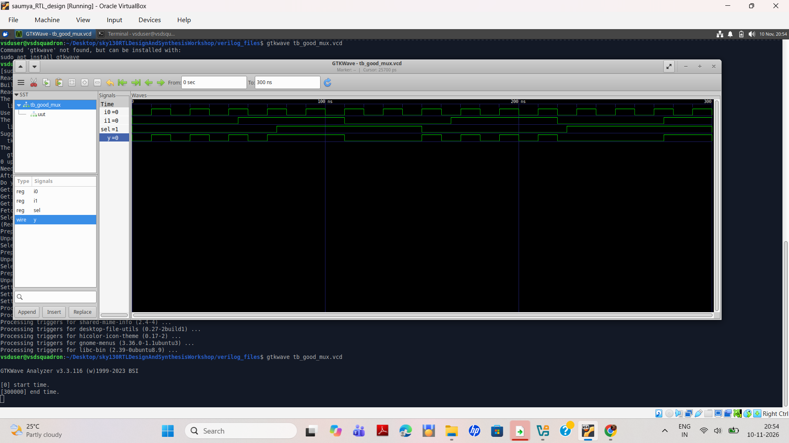
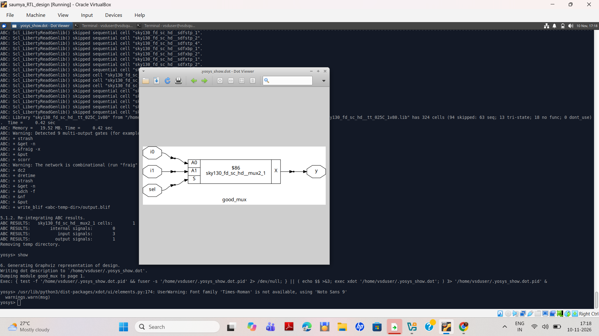

# Lab 1 — Sky130 Library, MUX Simulation and Synthesis

This lab covers three stages of the `good_mux` exercise:

1. Locate and load the Sky130 standard-cell Liberty library.
2. Compile and simulate the 2:1 MUX and inspect its waveform in GTKWave.
3. Synthesize the MUX using Yosys and view the mapped schematic.

**Environment:** Ubuntu inside Oracle VirtualBox  
**Repository:** `sky130RTLDesignAndSynthesisWorkshop`  
**RTL workspace:** `verilog_files`  
**Design:** `good_mux`

---

## Lab Folder and Screenshots

Keep all screenshots in the same `lab_1` folder as this README.


```text
lab_1/
├── README.md
├── folder_structure.png
├── library.png
├── mux_waveform.png
└── mux.png
```

---

## Step 1 — Sky130 Library Setup

### 1.1 Clone the repository

Run in Ubuntu Terminal:

```bash
cd ~/Desktop
git clone https://github.com/kunalg123/sky130RTLDesignAndSynthesisWorkshop.git
```

If you have already cloned the repository, do not clone it again.

```bash
cd ~/Desktop/sky130RTLDesignAndSynthesisWorkshop
```

### 1.2 Inspect the repository

```bash
ls -la
```

### 1.3 Locate the Sky130 Liberty file

```bash
ls -l lib/
```

Library file:

```text
lib/sky130_fd_sc_hd__tt_025C_1v80.lib
```

The Liberty file contains standard-cell information such as cell names, pins, timing and area.

### 1.4 Enter the Verilog directory

```bash
cd ~/Desktop/sky130RTLDesignAndSynthesisWorkshop/verilog_files
ls
```

Required files:

- `good_mux.v`
- `tb_good_mux.v`

### Screenshot — Library inspection



### 1.5 Read the library in Yosys

Start Yosys:

```bash
yosys
```

At the `yosys>` prompt:

```tcl
read_liberty -lib ../lib/sky130_fd_sc_hd__tt_025C_1v80.lib
```

Exit:

```tcl
exit
```

---

## Step 2 — MUX RTL Simulation and Waveform

### 2.1 RTL code — good_mux.v

```verilog
module good_mux (
    input  i0,
    input  i1,
    input  sel,
    output reg y
);

always @(*) begin
    if (sel)
        y <= i1;
    else
        y <= i0;
end

endmodule
```

Boolean expression:

\[
y = (\overline{sel} \land i0) \lor (sel \land i1)
\]

- When `sel = 0`, output `y = i0`.
- When `sel = 1`, output `y = i1`.

### 2.2 Testbench — tb_good_mux.v

Use the testbench supplied in the workshop repository. A typical testbench is:

```verilog
`timescale 1ns/1ps

module tb_good_mux;

reg i0, i1, sel;
wire y;

good_mux uut (
    .i0(i0),
    .i1(i1),
    .sel(sel),
    .y(y)
);

initial begin
    $dumpfile("tb_good_mux.vcd");
    $dumpvars(0, tb_good_mux);

    i0 = 0; i1 = 0; sel = 0;
    #10 i0 = 1; i1 = 0; sel = 0;
    #10 i0 = 0; i1 = 1; sel = 0;
    #10 i0 = 0; i1 = 1; sel = 1;
    #10 i0 = 1; i1 = 0; sel = 1;
    #10 i0 = 1; i1 = 1; sel = 0;
    #10 i0 = 0; i1 = 0; sel = 1;
    #10 $finish;
end

endmodule
```

The `$dumpfile` and `$dumpvars` commands generate the waveform file.

### 2.3 Install Icarus Verilog

If Icarus Verilog is not installed:

```bash
sudo apt update
sudo apt install iverilog -y
```

### 2.4 Compile the design

From the `verilog_files` directory:

```bash
iverilog -o good_mux_sim good_mux.v tb_good_mux.v
```

### 2.5 Run the simulation

```bash
vvp good_mux_sim
```

Check the generated waveform file:

```bash
ls -l tb_good_mux.vcd
```

### 2.6 Open GTKWave

Install GTKWave if required:

```bash
sudo apt install gtkwave -y
```

Open the waveform:

```bash
gtkwave tb_good_mux.vcd
```

Select these signals:

- `i0`
- `i1`
- `sel`
- `y`

### Screenshot — MUX waveform



### 2.7 Verify the output

| Select (`sel`) | Expected output |
|---|---|
| 0 | `y = i0` |
| 1 | `y = i1` |

The output must follow the input selected by `sel`.

---

## Step 3 — MUX Synthesis Using Yosys

### 3.1 Start Yosys

Run in Ubuntu Terminal:

```bash
cd ~/Desktop/sky130RTLDesignAndSynthesisWorkshop/verilog_files
yosys
```

### 3.2 Read the Liberty library and RTL

At the `yosys>` prompt:

```tcl
read_liberty -lib ../lib/sky130_fd_sc_hd__tt_025C_1v80.lib
read_verilog good_mux.v
hierarchy -top good_mux
```

### 3.3 Synthesize the MUX

```tcl
synth -top good_mux -noabc
```

### 3.4 Technology mapping using ABC

```tcl
abc -liberty ../lib/sky130_fd_sc_hd__tt_025C_1v80.lib
```

### 3.5 Display cell statistics

```tcl
clean
stat
```

### 3.6 Generate the schematic

```tcl
show
```

Yosys generates the schematic representation of the mapped MUX.

### Screenshot — Synthesized MUX schematic



### 3.7 Exit Yosys

```tcl
exit
```

---

## Complete Command Summary

### Ubuntu Terminal Commands

```bash
cd ~/Desktop/sky130RTLDesignAndSynthesisWorkshop/verilog_files

iverilog -o good_mux_sim good_mux.v tb_good_mux.v

vvp good_mux_sim

gtkwave tb_good_mux.vcd
```

### Yosys Commands

```tcl
read_liberty -lib ../lib/sky130_fd_sc_hd__tt_025C_1v80.lib

read_verilog good_mux.v

hierarchy -top good_mux

synth -top good_mux -noabc

abc -liberty ../lib/sky130_fd_sc_hd__tt_025C_1v80.lib

clean

stat

show

exit
```

---

## Troubleshooting

### Icarus Verilog not found

```bash
sudo apt update
sudo apt install iverilog -y
```

### GTKWave not found

```bash
sudo apt update
sudo apt install gtkwave -y
```

### VCD file not found

Check that the testbench contains:

```verilog
$dumpfile("tb_good_mux.vcd");
$dumpvars(0, tb_good_mux);
```

Run the simulation again:

```bash
vvp good_mux_sim
```

### RTL file not found

Check the current directory:

```bash
pwd
ls
```

Return to the Verilog workspace:

```bash
cd ~/Desktop/sky130RTLDesignAndSynthesisWorkshop/verilog_files
```

---

**Note:**

- `git`, `cd`, `ls`, `iverilog`, `vvp`, and `gtkwave` are Ubuntu Terminal commands.
- `read_liberty`, `read_verilog`, `synth`, `abc`, `stat`, and `show` are Yosys commands.

